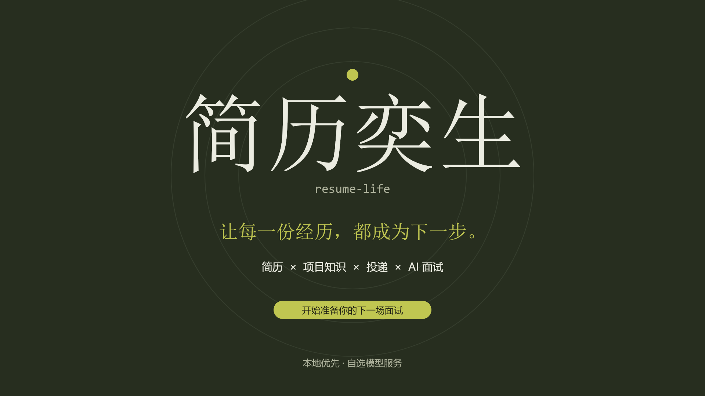

<p align="center">
  
</p>

<h1 align="center">简历奕生 · resume-life</h1>

<p align="center">本地优先的 AI 求职准备工具，连接简历、项目知识、投递和面试练习。</p>

<p align="center">
  <a href="#演示">演示</a> ·
  <a href="#功能">功能</a> ·
  <a href="#快速开始">快速开始</a> ·
  <a href="#数据与安全">数据与安全</a> ·
  <a href="#文档">文档</a> ·
  <a href="CONTRIBUTING.md">参与贡献</a>
</p>

<p align="center">
  <a href="LICENSE"></a>
  
  
</p>

## 演示

[](marketing/promo/resume-life.mp4)

<p align="center">
  <a href="marketing/promo/resume-life.mp4">30 秒宣传片</a> ·
  <a href="examples/README.md">虚构示例数据</a>
</p>

做过的项目、改过的简历、投过的岗位和练过的回答，可以在同一个本地工作台里串起来。项目材料形成简历素材，已发布简历绑定投递与 JD，练习和面试记录再进入复盘与间隔复习。

应用面向个人使用，通过本机单用户登录访问。简历与求职记录存入本机 SQLite；AI 功能调用你配置的模型服务，相关材料会发送至该服务。

## 功能

**整理项目材料 → 编辑并发布简历 → 绑定投递与 JD → 练习与模拟面试 → 复盘和复习。**

| 场景 | 可以做什么 |
| --- | --- |
| 简历管理 | PDF / Word / 文本导入、结构化编辑、不可变发布版本与历史分叉、岗位诊断、脱敏导出 PDF / DOCX / Markdown |
| 样式工厂 | 内置与自定义模板、AI 样式生成、实时 A4 预览 |
| 知识库 | 项目材料与仓库扫描、五维总结、增量对比与版本记录、摘取成果到简历 |
| 模拟面试 | 基于 JD 与已发布简历动态出题、追问与评分；进阶三轮面试及跨轮总评 |
| 题目练习、自我介绍 | 项目深挖与岗位题练习；30 秒 / 2 分钟介绍生成、点评与背诵 |
| 岗位题库、错题本、复盘看板 | 分类题库、答案快照、多维评分趋势、间隔复习、遮答重答与作答历史 |
| 求职看板 | 投递批次与阶段漏斗、流程履历、面试日程、准备资料与待办、逐题复盘、固定版本对比 |
| 工具箱 | JD 画像、黑话解码、简历排雷、空窗期沟通、薪资谈判练习、作品集静态 ZIP 导出 |
| 设置 | 任务级模型、连接测试、网络代理、调用用量统计、加密备份与恢复 |

## 快速开始

需要 **Node.js `>=24.21.0 <25`** 和 npm。`.nvmrc` 与 `.node-version` 固定已验证的 Node 版本。

获取源码并进入目录；已有源码时直接在项目根目录执行后面的安装步骤：

```bash
git clone https://github.com/yhxjs/resume-life.git
cd resume-life
```

以下命令可在 PowerShell 或 POSIX shell 执行：

```bash
npm ci
node -e "require('node:fs').writeFileSync('.env.local', 'RESUME_LIFE_SETTINGS_KEY=' + require('node:crypto').randomBytes(32).toString('hex') + '\n', { flag: 'wx', mode: 0o600 })"
npm run setup:ocr
npx playwright install chromium
npm run dev
```

打开 [http://127.0.0.1:3714](http://127.0.0.1:3714)，初始化本机用户名和密码。首次启动会在 `data/` 创建数据库。

- **保管密钥**：生成 `.env.local` 的命令只执行一次，已有文件会拒绝覆盖。已有配置时，将独立生成的随机密钥填入 `RESUME_LIFE_SETTINGS_KEY`。重启时沿用同一密钥，并与数据库、备份分开保管。
- **准备 OCR**：`setup:ocr` 首次从 jsDelivr 下载中英文语言包，校验大小与 SHA-256；识别时使用本地模型。CDN 不可达时可按 [OCR 下载与路径排障](docs/TROUBLESHOOTING.md#10-本地-ocr-语言包) 从官方 npm 获取同版本模型。准备与运行时须使用同一 OCR 目录。
- **安装 Chromium**：用于 PDF 导出和浏览器测试，应安装在运行应用的同一用户下。Linux 可能还需 `npx playwright install --with-deps chromium`。
- **连接模型**：在「设置」填写 Base URL、API Key 和任务模型，完成连接测试。支持 OpenAI Chat Completions、Anthropic Messages、OpenAI Responses，以及 HTTP / HTTPS / SOCKS5 代理。

可以先从 [虚构简历与职位示例](examples/README.md) 开始。手动编辑、题库和投递管理可独立使用；AI 解析、总结、生成和评分需要模型服务，采用或投递前请人工核对结果。

生产运行：

```bash
npm run build
npm start
```

开发与生产命令默认监听 `127.0.0.1:3714`。远程访问与服务部署见 [部署说明](docs/DEPLOYMENT.md)。

## 配置

完整示例见 [.env.example](.env.example)。模型地址、API Key、任务模型和代理在设置页保存。

| 环境变量 | 用途 |
| --- | --- |
| `RESUME_LIFE_SETTINGS_KEY` | AI API Key 与代理密码的加密密钥；所有非测试运行保存凭证前必填，随机生成并在重启时保持一致 |
| `RESUME_LIFE_DATA_DIR` | 数据库、头像与恢复前快照的绝对目录；默认 `<项目根目录>/data` |
| `RESUME_LIFE_OCR_DATA_DIR` | OCR 模型的绝对目录；默认当前工作目录 |
| `RESUME_LIFE_ALLOWED_HOSTS` | 额外允许的 Host，逗号分隔；本机使用通常留空 |
| `RESUME_LIFE_SECURE_COOKIES` | HTTPS 反向代理部署时设为 `true`；本机 HTTP 留空 |
| `RESUME_LIFE_AUTH_REINIT` | 忘记密码时临时启用的凭证重新初始化入口，完成后清除；见 [部署说明](docs/DEPLOYMENT.md#对外访问风险) |

仅手动使用且不保存凭证时可不设置加密密钥。它用于保护数据库中的凭证，区别于模型服务的 API Key。数据目录必须可写；改变启动工作目录时，应显式设置数据和 OCR 的绝对路径。

## 数据与安全

**用于本机或受控网络。** 业务页面和接口需要本机单用户登录。远程访问需要反向代理 TLS、访问控制、允许的 Host 与安全 Cookie；具体边界见 [部署说明](docs/DEPLOYMENT.md#对外访问风险)。

- **AI 数据流向**：相关简历、JD、项目材料和作答会发送至你选择的模型服务。使用前确认服务的隐私政策、数据处理方式及调用费用。
- **凭证保护**：数据库中的 API Key 和代理密码使用 `RESUME_LIFE_SETTINGS_KEY` 做 AES-256-GCM 加密；同时用操作系统权限保护数据目录。
- **分享范围**：发布或分享前排除 `data/`、环境文件、上传头像、模型文件，以及含真实信息的截图与备份。
- **仓库扫描**：源码采集按白名单和预算过滤后发送至本机 CLI；CLI 在空临时目录运行并关闭文件、命令和外部工具。扫描前仍需清理自定义业务秘密。Codex 扫描会跳过用户自定义 model/provider 等配置，需要自定义服务时可使用 Claude CLI 或应用内 API；详见 [仓库扫描架构](docs/ARCHITECTURE.md#repo-scanner)。

### 备份与恢复

数据库结构版本为 **6**。设置页导出 `.rlbackup` 加密备份，密码为 12–256 个 Unicode code point；备份密码不会持久化，遗失后无法恢复。

备份包含业务数据与引用的私有头像，API Key、代理密码和应用加密密钥不随备份携带。恢复默认保留当前设备的 AI 配置，恢复前创建数据库与头像快照。格式兼容、快照轮转和恢复故障处理见 [备份与恢复排障](docs/TROUBLESHOOTING.md#4-备份与恢复)。

安全问题请按 [SECURITY.md](SECURITY.md) 提供脱敏信息。

## 开发与验证

技术栈：Next.js 16 / React 19 / TypeScript / Tailwind CSS 4，Node 内置 `node:sqlite`，Playwright PDF 导出，Tesseract.js 本地 OCR。

```bash
npm run check:release
npm run test:coverage
npm run check:page-coverage
```

`check:release` 依次运行依赖审计、公开资产检查、单元测试、lint、类型检查、生产构建、构建追踪和 E2E。覆盖率门槛为行 85%、函数 78%、分支 77%；另有页面与布局覆盖门槛。测试使用独立临时数据库，完整开发准备及单项命令见 [贡献指南](CONTRIBUTING.md)。

`npm ci` 会执行固定哈希的 picomatch 安装期补丁，保留上游身份和许可证。`npm run audit:dependencies` 保存原始审计报告并核对补丁与精确政策。2026-11-18 的原始完整报告有 **14 个 high 开发依赖传播节点**，生产依赖为零；限时例外于 **2026-12-18 08:00（香港时间）**到期。新增公告、依赖图变化、哈希漂移或到期均会阻断，详情见 [安全政策](SECURITY.md)。

当前本地发布验证在 Windows / Node.js 24.21.0 完成。[GitHub Actions](https://github.com/yhxjs/resume-life/actions/workflows/check.yml) 配置 Linux 完整发布检查及 Windows 检查；Linux 实际执行结果尚未验证。

## 文档

| 需要了解什么 | 文档 |
| --- | --- |
| 安装、部署与故障处理 | [部署说明](docs/DEPLOYMENT.md) · [故障排查](docs/TROUBLESHOOTING.md) |
| 数据、安全与许可 | [数据生命周期](docs/DATA-LIFECYCLE.md) · [安全政策](SECURITY.md) · [第三方许可](docs/THIRD_PARTY_NOTICES.md) |
| 功能与产品设计 | [产品说明](PRODUCT.md) · [设计说明](DESIGN.md) · [需求与边界](docs/REQUIREMENTS.md) |
| 开发与架构 | [API 契约](docs/API.md) · [架构](docs/ARCHITECTURE.md) · [领域术语](CONTEXT.md) · [架构决策](docs/ADR.md) |
| 上手与参与 | [虚构示例](examples/README.md) · [贡献指南](CONTRIBUTING.md) · [更新日志](CHANGELOG.md) |

## 贡献与许可

欢迎通过代码、测试或文档参与，提交前阅读 [贡献指南](CONTRIBUTING.md) 与 [行为准则](CODE_OF_CONDUCT.md)。

[MIT](LICENSE) · Copyright (c) 2026 yhxjs
