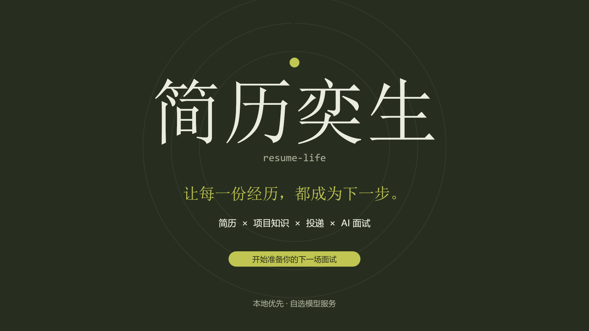

<p align="center">
  
</p>

<h1 align="center">简历奕生 · resume-life</h1>

<p align="center">本地优先的 AI 求职准备工具，连接简历、项目知识、投递和面试练习。</p>

<p align="center">
  <a href="#演示">演示</a> ·
  <a href="#功能">功能</a> ·
  <a href="#快速开始">快速开始</a> ·
  <a href="#数据与安全">数据与安全</a> ·
  <a href="#文档">文档</a> ·
  <a href="CONTRIBUTING.md">参与贡献</a>
</p>

<p align="center">
  <a href="LICENSE"></a>
  
  
</p>

## 演示

[](marketing/promo/resume-life.mp4)

<p align="center">
  <a href="marketing/promo/resume-life.mp4">30 秒宣传片</a> ·
  <a href="examples/README.md">虚构示例数据</a>
</p>


面向个人使用的本地单用户应用，提供单用户本地登录，不提供公开注册、多用户或托管服务。简历、项目材料和练习记录存入本机 SQLite；AI 功能由你配置的模型服务提供，相关内容会发送至该服务，并非全离线应用。

## 功能

**整理项目材料 → 编辑并发布简历 → 绑定投递与 JD → 定向练习或模拟面试 → 复盘和间隔复习。**

| 场景 | 能力 |
| --- | --- |
| 简历管理 | 结构化编辑，PDF / Word / 文本导入，发布版本与历史分叉，岗位诊断，脱敏导出 PDF / DOCX / Markdown |
| 样式工厂 | 内置与自定义模板，AI 样式生成，A4 预览 |
| 知识库 | 项目材料与仓库扫描，五维总结、增量对比与版本记录，摘取成果到简历 |
| 模拟面试 | 基于 JD 与已发布简历动态出题、追问和评分，进阶三轮面试与跨轮总评 |
| 题目练习、自我介绍 | 项目出题与逐题评分；30 秒 / 2 分钟介绍生成、点评与背诵 |
| 岗位题库、错题本、复盘看板 | 按方向沉淀题目，收藏答案快照，评分趋势；间隔复习、遮答重答与作答历史 |
| 求职看板 | 投递批次与流程履历、阶段漏斗、面试日程、准备资料与待办、逐题复盘、投递固定版本对比 |
| 工具箱 | JD 画像、黑话解码、简历排雷、空窗期对策、薪资谈判，以及可独立部署的作品集静态 ZIP 导出 |
| 设置 | 任务级模型、连接测试、网络代理、调用用量统计与加密备份 |

## 快速开始

需要 **Node.js `>=24.21.0 <25`** 和 npm；`.nvmrc`、`.node-version` 固定已验证的 Node 版本。以下命令均在项目根目录执行：

```bash
npm ci
node -e "require('node:fs').writeFileSync('.env.local', 'RESUME_LIFE_SETTINGS_KEY=' + require('node:crypto').randomBytes(32).toString('hex') + '\n', { flag: 'wx', mode: 0o600 })"
npm run setup:ocr
npx playwright install chromium
npm run dev
```

打开 [http://127.0.0.1:3714](http://127.0.0.1:3714)，初始化本机用户名和密码。首次启动会在 `data/` 创建数据库。

- 生成 `.env.local` 的命令只执行一次，已有文件会拒绝覆盖；已有环境配置时，将独立生成的随机加密密钥填入 `RESUME_LIFE_SETTINGS_KEY`。妥善保管该文件，重启时沿用同一个密钥；不要放入数据目录、备份或分享材料。所有非测试运行（包括 `npm run dev`）保存 API Key 或代理密码前都需要这个密钥。
- `setup:ocr` 下载中文和英文语言包并校验 SHA-256；识别时仅读取本地模型，不自动联网下载。
- 本地 OCR 默认要求中英文语言；初始化失败会明确报错，不会静默改用英文识别。检查本地语言包与 `RESUME_LIFE_OCR_DATA_DIR`，或在设置中切换至已配置的多模态识别后重试。
- Chromium 用于 PDF 导出和浏览器测试，需要安装在运行应用的同一用户下。Linux 可能还需 `npx playwright install --with-deps chromium`。
- 在「设置」填写 Base URL、API Key 和任务模型，完成连接测试。支持 OpenAI Chat Completions、Anthropic Messages 和 OpenAI Responses 三种协议，以及 HTTP / HTTPS / SOCKS5 代理。
- 不启用 AI 时仍可手动编辑简历、维护题库与投递；解析、总结、生成和评分等 AI 流程需要模型服务。

生产运行：

```bash
npm run build
npm start
```

开发与生产命令默认仅监听 `127.0.0.1:3714`。首次使用可从 [虚构简历与职位示例](examples/README.md) 开始，在保存或投递前人工核对 AI 结果。

## 配置

保存 AI 凭证需要先配置 `RESUME_LIFE_SETTINGS_KEY`；仅手动使用且不保存凭证时可留空。完整环境配置见 [.env.example](.env.example)，部署方式见 [部署说明](docs/DEPLOYMENT.md)。

| 环境变量 | 用途 |
| --- | --- |
| `RESUME_LIFE_DATA_DIR` | 数据库、头像与恢复前快照的绝对目录；默认 `<项目根目录>/data` |
| `RESUME_LIFE_SETTINGS_KEY` | API Key 与代理密码的加密密钥；所有非测试运行保存凭证前必填，随机生成、独立保管并在重启时保持一致 |
| `RESUME_LIFE_OCR_DATA_DIR` | OCR 模型的绝对目录；默认当前工作目录，准备与运行时须指向同一位置 |
| `RESUME_LIFE_ALLOWED_HOSTS` | 额外允许的 Host，逗号分隔；本机使用通常留空 |
| `RESUME_LIFE_SECURE_COOKIES` | HTTPS 反向代理部署时设为 `true`，本机 HTTP 留空 |
| `RESUME_LIFE_AUTH_REINIT` | 置为 `true` 后允许在登录页重新初始化用户名和密码（忘记密码时的逃生门）；平时务必留空 |

模型服务地址、API Key 和任务模型在设置页保存；以上加密密钥用于保护这些凭证，不是模型服务的 API Key。数据目录必须可写；改变启动工作目录时，请显式设置数据和 OCR 路径。

## 数据与安全

**仅用于本机或受控网络。** 业务页面与接口需要本机单用户登录；认证入口与健康检查公开。远程访问须配置反向代理 TLS、访问控制、允许的 Host 和安全 Cookie，详见 [部署说明](docs/DEPLOYMENT.md#对外访问风险)。

- AI 请求会把相关简历、JD、项目材料或作答发送至你选择的服务。提交前确认其隐私政策、数据处理方式及调用费用。
- 数据库内的 API Key 和代理密码使用 `RESUME_LIFE_SETTINGS_KEY` 做 AES-256-GCM 加密；密钥应独立保管，仍须用操作系统权限保护数据目录。
- 不要公开、提交或分享 `data/`、上传头像、环境文件、模型文件以及包含真实信息的截图；不要把整个运行目录打包作为分享材料。

<details>
<summary>登录、仓库扫描与 CLI 边界</summary>

首次初始化和凭证逃生门都只接受回环 Host。会话有效期为 7 天，期间有访问会自动续期。忘记密码时，将 `RESUME_LIFE_AUTH_REINIT` 置为 `true` 并重启，回环访问初始化接口后当前进程会自动清除该变量，其他进程和服务管理器中的变量仍需手动移除。失败登录超过每分钟 5 次或密码校验并发超过 2 个会返回 429；这些预算和模型并发预算写入数据目录的 `process-budgets.db`，支持多个 Node 进程共享。

仓库扫描只将应用收集的源码白名单材料发送给本机 CLI；材料总预算约 18 万字符，单文件最多读取 32 KB，超限会注明截断。环境文件、明显凭证字段/连接串、运行数据、依赖目录、符号链接与仓库中的代理指令文件排除。文件名或关键字无法识别所有业务秘密，扫描前仍须清理自定义敏感内容。CLI 在空临时目录运行且关闭文件、命令和外部工具，模型服务与费用由该 CLI 决定。

Codex 扫描使用 `--ignore-user-config`，保留本机登录认证，但不继承 `config.toml` 中的自定义模型、provider、MCP、插件或 hooks；另显式关闭 apps/plugins 与命令执行功能。使用自定义 Codex provider 的用户应选择已配置的 Claude CLI，或通过应用模型设置使用 API 生成总结。Claude 保留模型连接，使用空工具列表、safe mode 与严格 MCP 配置。CLI 需支持这些旗标；旧版不兼容时会明确失败，请升级后重试。服务器的管理员级 CLI 策略与配置属于部署信任边界，部署前须确认未额外启用外部工具。

应用在 POSIX 系统创建数据目录、SQLite、头像和恢复暂存文件时会主动收紧为服务账户可读写。

</details>

<details>
<summary>数据库版本、加密备份与恢复</summary>

- 数据库结构版本为 **1**。空库自动初始化当前完整结构；已有 v1 库必须通过结构与外键校验，其他版本或结构不匹配时拒绝打开，不修改原数据。
- 设置页导出 `.rlbackup` 加密备份，密码为 **12–256 个 Unicode code point**。应用不持久化备份密码，遗失后无法恢复。
- 首版备份 manifest 为 **1.0.0**，加密头版本为 **1**；只接受完整首版格式，不支持 JSON 文件或其他版本。
- 备份包含全部业务数据、服务地址、模型名等普通设置与数据库引用的私有头像，API Key 和代理密码均不携带；恢复默认保留当前设备的 AI 配置。取消勾选会还原备份中的普通设置，需重新填写凭证。
- 恢复前创建数据库与头像快照，校验或提交失败不覆盖原数据。快照轮转、手动回退及临时解密文件处理见 [备份与恢复排障](docs/TROUBLESHOOTING.md#4-备份与恢复)。

</details>

安全问题请按 [SECURITY.md](SECURITY.md) 提供脱敏信息，不上传真实数据库或原始请求内容。

## 开发与验证

技术栈：Next.js 16 / React 19 / TypeScript / Tailwind CSS 4，Node 内置 `node:sqlite` 存储，Playwright 导出 PDF，Tesseract.js 离线 OCR。

```bash
npm run check:release
npm run test:coverage
npm run check:page-coverage
npm audit --omit=dev --audit-level=moderate
npm audit --audit-level=high
```

`check:release` 包含公开资产检查、单测、Lint、类型、生产构建、构建追踪与 E2E。测试使用独立临时数据库，不读取日常 `data/`；不要把测试数据目录指向个人数据库。

当前已在 Windows、Node 24.21.0 验证。GitHub Actions 配置 Linux 完整发布检查与 Windows 检查任务，Linux 实际执行结果尚未验证，不声明已通过。

<details>
<summary>目录与单项检查</summary>

```text
src/app/          页面与 API 路由
src/components/   业务组件与界面
src/lib/          领域逻辑、数据库与 AI 调用
src/hooks/        客户端 hooks
tests/e2e/        浏览器与真实 API 流程
scripts/          运行时、OCR 与发布检查
docs/             部署、接口、架构和安全边界
examples/         虚构示例数据
```

```bash
npm test
npm run lint -- --max-warnings=0
npm run typecheck
npm run build
npm run check:build-trace
npm run test:e2e
```

更多开发约定见 [贡献指南](CONTRIBUTING.md)。

</details>

## 文档

[部署](docs/DEPLOYMENT.md) · [故障排查](docs/TROUBLESHOOTING.md) · [数据生命周期](docs/DATA-LIFECYCLE.md) · [API 契约](docs/API.md) · [架构](docs/ARCHITECTURE.md) · [需求与边界](docs/REQUIREMENTS.md) · [领域术语](CONTEXT.md) · [架构决策](docs/ADR.md) · [第三方许可](docs/THIRD_PARTY_NOTICES.md) · [更新日志](CHANGELOG.md)

## 贡献与许可

欢迎通过代码、测试或文档参与，提交前阅读 [贡献指南](CONTRIBUTING.md) 与 [行为准则](CODE_OF_CONDUCT.md)。

[MIT](LICENSE) · Copyright (c) 2026 yhxjs
