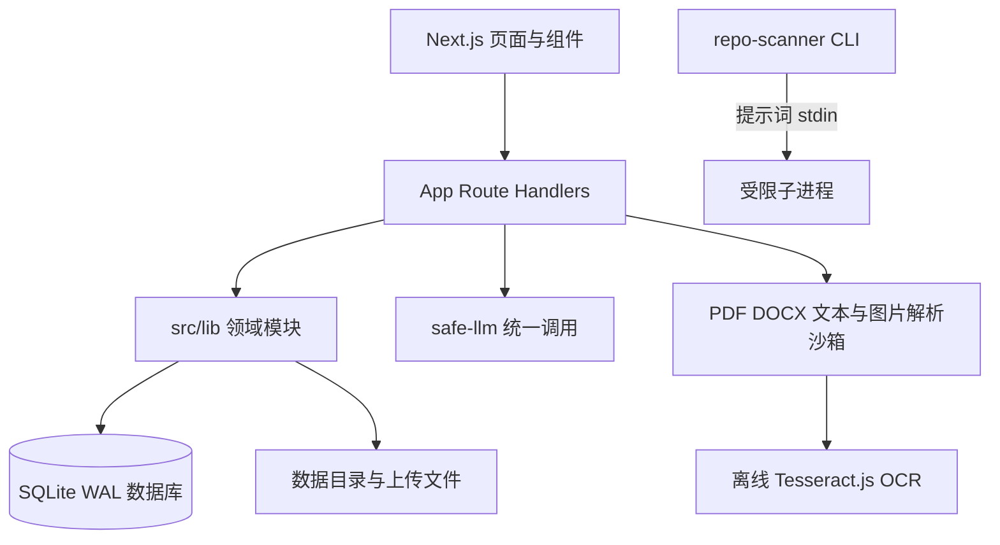

# 架构说明

简历奕生（resume-life）是一个 Next.js 全栈单体应用，面向本机单用户使用。数据默认保存在 SQLite，页面、API、领域模块和本地文件解析都在同一个 Node.js 进程中运行。

## 总体结构

## 领域边界

- `src/app` 提供页面和 HTTP Route Handlers；请求体、来源、上传大小和错误响应在边界处处理。
- `src/lib` 保存简历、版本、投递、复盘、备份、作品集、解析和安全工具等领域逻辑。
- `src/components` 负责交互和视图，不直接拥有跨路由的 SQL 写入逻辑。
- SQLite 是本机数据源；涉及多表写入的流程使用事务，发布版本和草稿保持可区分的快照语义。
- `data/`、头像和 OCR 模型是运行时资产，不属于公开源码集合。

## 核心流程

### 简历与版本

编辑器保存草稿，发布动作创建不可变版本快照。投递可以固定使用某个已发布版本；版本对照支持已发布版本与空白参照，空白参照只显示当前版本新增内容。

### AI 解析与确认

AI 解析只生成草稿候选结果，用户确认后才写入简历。用户可控文本作为不可信输入传递给 `safe-llm`，不能在 LLM 提示词中手拼标签边界。

### 文件解析与 OCR

PDF、DOCX 和图片导入在大小、页数、字符数及临时目录边界内处理。离线 OCR 要求运行前执行 `npm run setup:ocr`，识别路径只从本地绝对目录读取，不因识别失败而隐式联网。

### 备份与上传

备份导出、校验和恢复拥有独立的校验与事务边界。上传文件先经过类型、大小、名称和路径检查。

普通 API 通过 `data-generation.ts` 的请求上下文固定数据世代；模型返回、流事件发送和数据库事务提交前都复核世代。成功恢复更换持久世代，旧任务返回冲突或 SSE 错误，不能写回恢复后的复用 ID。恢复端点显式退出这层保护，以便完成自身的世代替换。介绍版本的三种写路径集中在 `intro-versions.ts`，修订令牌绑定世代与原始版本快照，事务内通过 CAS 拒绝旧标签页覆盖。

根布局在 `connection()` 之后读取当前世代并输出 meta，避免构建期读运行数据。客户端 `apiFetch` 为文档固定该值，JSON/SSE/上传/下载统一携带世代头；API 包装器在 handler 之前拒绝旧文档，再由事务保护争锁期间的恢复。后台响应和 SPA 更新不能自动推进旧文档世代，恢复后需整页刷新；脚本调用可显式携带响应世代头获得同样保护。

### repo-scanner

应用先收集有预算的源码白名单材料，再经 stdin 传给 CLI。环境/凭证文件、运行数据、依赖、符号链接与代理指令文件排除；CLI 在空临时目录运行且关闭模型文件/命令工具。Windows 下 `.cmd`/`.bat` 经 `cmd.exe` 中转，argv 只含固定旗标和始终引用的可执行路径，动态仓库路径不进入命令行。POSIX 子进程建立独立进程组；两条 CLI 路径共享并发、输出、超时与取消保护。

Codex 跳过用户 `config.toml`（认证仍使用本机登录），并关闭 apps/plugins、hooks 与命令执行功能。该隔离也会跳过自定义 model/provider；需要自定义服务时使用 Claude 或应用内 API。空 TOML 表覆盖会递归合并而保留已有 MCP 条目，因此不能用 `mcp_servers={}` 代替配置隔离。管理员级 CLI 配置仍须在部署时审查。

## 安全边界

默认服务只监听 `127.0.0.1`，应用有内置单用户登录，没有注册、多用户或租户隔离。首次初始化的授权与写入在同一事务检查，登录使用有界异步密码校验和失败限速。反向代理部署仍需要 TLS、访问控制与备份策略，显式配置允许的 Host 和 Secure Cookie。详见 [部署说明](DEPLOYMENT.md)、[API 契约](API.md) 和现有 ADR：

- [原单用户无认证决策（已部分替代）](ADR.md#adr-0001)
- [单用户登录与受限 CLI 材料](ADR.md#adr-0004)
- [Next.js 单体与 SQLite](ADR.md#adr-0002)
- [收藏时保存笔记快照](ADR.md#adr-0003)
