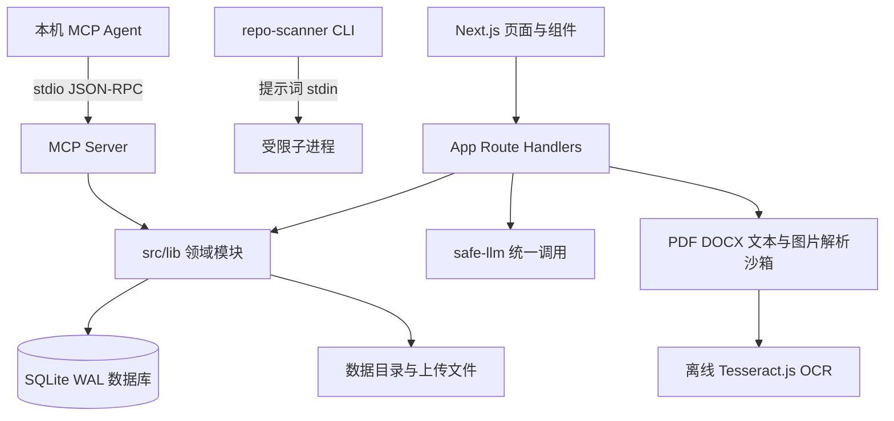

# 架构说明

简历奕生（resume-life）是一个 Next.js 全栈单体应用，面向本机单用户使用。数据默认保存在 SQLite，页面、API、领域模块和本地文件解析都在同一个 Node.js 进程中运行。

## 总体结构

## 领域边界

- `src/app` 提供页面和 HTTP Route Handlers；请求体、来源、上传大小和错误响应在边界处处理。
- `src/lib` 保存简历、版本、投递、复盘、备份、作品集、解析和安全工具等领域逻辑。
- `src/components` 负责交互和视图，不直接拥有跨路由的 SQL 写入逻辑。
- SQLite 是本机数据源；涉及多表写入的流程使用事务，发布版本和草稿保持可区分的快照语义。
- `data/`、头像和 OCR 模型是运行时资产，不属于公开源码集合。

## 核心流程

### 简历与版本

编辑器保存草稿，发布动作创建不可变版本快照。投递可以固定使用某个已发布版本；版本对照支持已发布版本与空白参照，空白参照只显示当前版本新增内容。

### AI 解析与确认

AI 解析只生成草稿候选结果，用户确认后才写入简历。用户可控文本作为不可信输入传递给 `safe-llm`，不能在 LLM 提示词中手拼标签边界。

### 文件解析与 OCR

PDF、DOCX 和图片导入在大小、页数、字符数及临时目录边界内处理。离线 OCR 要求运行前执行 `npm run setup:ocr`，识别路径只从本地绝对目录读取，不因识别失败而隐式联网。

### 备份与上传

备份导出、校验和恢复拥有独立的校验与事务边界。上传文件先经过类型、大小、名称和路径检查。

普通 API 通过 `data-generation.ts` 的请求上下文固定数据世代；模型返回、流事件发送和数据库事务提交前都复核世代。成功恢复更换持久世代，旧任务返回冲突或 SSE 错误，不能写回恢复后的复用 ID。恢复端点显式退出这层保护，以便完成自身的世代替换。介绍版本的三种写路径集中在 `intro-versions.ts`，修订令牌绑定世代与原始版本快照，事务内通过 CAS 拒绝旧标签页覆盖。

根布局在 `connection()` 之后读取当前世代并输出 meta，避免构建期读运行数据。客户端 `apiFetch` 为文档固定该值，JSON/SSE/上传/下载统一携带世代头；API 包装器在 handler 之前拒绝旧文档，再由事务保护争锁期间的恢复。后台响应和 SPA 更新不能自动推进旧文档世代，恢复后需整页刷新；脚本调用可显式携带响应世代头获得同样保护。

### repo-scanner

应用先收集有预算的源码白名单材料，再经 stdin 传给 CLI。环境/凭证文件、运行数据、依赖、符号链接与代理指令文件排除；CLI 在空临时目录运行，内置模式关闭模型文件/命令工具。Windows 下 `.cmd`/`.bat` 经 `cmd.exe` 中转，argv 只含固定参数和始终引用的路径，动态仓库路径与材料不进入命令行。POSIX 子进程建立独立进程组；内置及自定义 CLI 共享并发、输出、超时与取消保护。

自定义客户端通过 `customCli: {command,args}` 配置，服务端只解析明确指定的程序，启动前校验参数并解析 PATH；不经过通用 shell 拆分，不插入提示词占位符。自定义模式的关联预检直接使用相同客户端，失败返回未知关系，不回退到应用模型或内置 CLI。第三方客户端或 SDK 包装脚本自行控制工具权限；空临时工作目录不是 OS 沙盒。配置可在当前浏览器保存多套，不写入数据库或项目备份，退出或清理敏感副本时移除。详见 [自定义客户端接入](CUSTOM-CLI.md)。

内置 Codex 模式跳过用户 `config.toml`（认证仍使用本机登录），并关闭 apps/plugins、hooks 与命令执行功能。该隔离也会跳过自定义 model/provider；需要自定义服务时使用自定义客户端、Claude 或应用内 API。空 TOML 表覆盖会递归合并而保留已有 MCP 条目，因此不能用 `mcp_servers={}` 代替配置隔离。管理员级 CLI 配置仍须在部署时审查。

## 本机 MCP 接入

`scripts/mcp.mjs` 从自身位置定位项目，提供 serve/doctor/config，调用 `src/mcp/stdio.ts` 的官方 TypeScript MCP SDK stdio Server。`src/mcp/tools.ts` 保留 SDK 发现与传输，在 tools/call 入口统一白名单、输入预算/校验、结构化输出、错误码、超时取消和操作元数据；业务处理运行在数据世代作用域内。`mcp-read.ts`/`mcp-records.ts` 提供有界摘要、分页及修订令牌约束的完整 JSON 分段读取，写操作复用领域事务与并发校验。

默认注册 99 个只读工具；63 个业务写工具和 3 个模型生成工具通过独立开关启用，工具白名单进一步收窄权限，并同步约束 Resources/Prompts。只读、准备管理、外部模型协作、训练、资料创作五种预设生成具体能力清单。`output-schemas.ts` 为全部工具声明详细字段和互斥的成功/失败契约；准备资料、诊断历史、自我介绍版本、进阶面试与复习记录支持分页或完整读取。准备计划、待办和真实面试写路径复用领域模块，修订令牌约束网页与 MCP 并发修改。

`drill-grading.ts` 固定题目与实际评分依据，作答、补齐收藏快照和登记追练卡同事务提交。`interview-session-store.ts` 由网页和 MCP 共用：建场写入首题、推进最后一个未答回合、用原始评分汇总报告。外部训练工具只接收 Agent 提供的结构化结果，不隐式调用应用模型。介绍预览以版本和完整新稿计算确认令牌；手工材料、文件导入和仓库证据通过共用项目材料领域模块写入，文件来源与增量历史分别保留可核对的元数据。

题库建场逐字保存有效原题；网页重练通过 `readBankDrillSource` 固定原场次选题、方向与 JD，生成后在事务内复核，完整选题超预算时拒绝。评分规则由 `drillEvaluationRules` 同时供网页和 MCP 使用，含条件性的 DOCX 表格判读指令，MCP 评分修订同时绑定完整规则。介绍点评按未改写原文及重复出现顺序保留；`mcp-project-revision.ts` 计算包含全部材料正文和来源标记的修订，避免分页预览或同毫秒时间戳掩盖修改。

`mcp-state.ts` 将创建回执与业务写入原子提交；`mcp-ai.ts` 将生成和保存分开，并向外部模型提供相同的来源令牌、上下文及结果 JSON schema。外部提交沿用领域结果校验，临时草稿绑定来源修订令牌，保存时复核后关联业务资料。`mcp-generation.ts` 在来源读取事务内认领请求键，模型等待在事务外进行，草稿和成功状态原子提交；持久键用于跨进程去重、重启恢复和查找已保存结果，失败或中断的键不重新调用模型。后台定时维护清理过期正文，保留请求墓碑。

v9 的 MCP 回执、操作日志、临时草稿，v10 的生成请求、v11 的生成阶段及 v12 的批量操作结果均为本机运行表，不进入用户备份；恢复清除草稿、缓存正文及批量结果，并使旧世代请求和文件产物失效。v11 的 `notebook_notes` 是独立用户业务表，进入备份，保存补充笔记时不修改原题、原答和反馈快照。网页和 MCP 共用 `notebook-storage.ts` 的收藏/笔记事务，`mcp-review.ts` 复用复习领域的排期和提交校验。stdio 直接读取本机数据库，OS 用户、文件权限和 Agent 配置是信任边界；功能范围仅为本机 stdio。详见 [MCP 接入](MCP.md)。

1.4 的诊断采纳、排版、题库、分类及黑话写入与网页共用领域模块；发布和历史分支复用版本事务。`mcp-artifacts.ts` 通过固定产物 ID、已提交回执及数据世代控制文件读取，复用实际 Markdown/PDF/DOCX/ZIP 渲染器，提交前再次核对来源。`RESUME_LIFE_MCP_REPO_ROOTS` 只允许从配置目录索引采集受限源码，保存具体文件定位及片段哈希；不执行仓库程序或模型。工作流目录描述所需权限和恢复步骤，完整示例使用独立 stdio 进程及真实 Codex Host 验证。

### MCP 1.5 运行与证据存储

持久任务由 `mcp-jobs` 管理，跨进程渲染/采集/解析租约由 `mcp-work-leases` 管理；原操作及原幂等回执仍是提交事实的依据。事务提交前检查期限、取消、租约和恢复世代。`mcp-cache` 统一管理缓存期限、容量及可预览清理，`mcp-uploads` 验证分块偏移与完整哈希；文件解析复用网页领域规则。

模板与头像的网页/MCP 写入分别共享 `template-store` 和 `avatar-upload`。仓库增量更新将正式版本原文与材料快照存入 v13 的 `project_repository_evidence`，随业务备份保留；`mcp_*` 运行状态不导出。`mcp-search` 在授权领域内提供有界片段和基于只读快照、领域变动计数及键集游标的分页。28 项工作流及 169 个工具的契约由 `scripts/check-mcp-contract.mjs` 从真实 stdio 服务生成并核对。

## 安全边界

默认服务只监听 `127.0.0.1`，应用有内置单用户登录，没有注册、多用户或租户隔离。首次初始化的授权与写入在同一事务检查，登录使用有界异步密码校验和失败限速。反向代理部署仍需要 TLS、访问控制与备份策略，显式配置允许的 Host 和 Secure Cookie。详见 [部署说明](DEPLOYMENT.md)、[API 契约](API.md) 和现有 ADR：

- [原单用户无认证决策（已部分替代）](ADR.md#adr-0001)
- [单用户登录与受限 CLI 材料](ADR.md#adr-0004)
- [Next.js 单体与 SQLite](ADR.md#adr-0002)
- [收藏时保存笔记快照](ADR.md#adr-0003)
